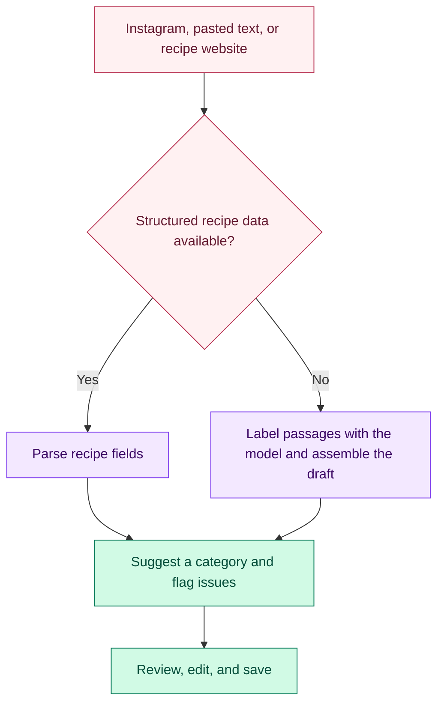

<div align="center">

# 🍓 AI Recipe Extraction Assistant

**Turn saved recipe links and text into a searchable Hebrew recipe notebook.**

I built this app because my recipes were scattered across Instagram, websites, and notes. It turns those sources into editable drafts I can review before saving.

[](https://recipe-notebook-5fi.pages.dev)
[](https://recipe-notebook-5fi.pages.dev/#/recipes/12/source)


[How it works](#how-it-works) · [Evaluation](#what-i-measured) · [Run locally](#run-locally-with-ollama) · [Guides](#limitations-and-further-reading)

</div>

> **About the demo:** The public notebook is read-only. You can browse saved recipes and explore recorded examples of extraction and review. Importing, running the model, and editing happen in the local app.

## What it does

| Feature | What you can do |
| --- | --- |
| 📥 **Import** | Start from pasted text, a public Instagram post, or a supported recipe website. |
| 🔎 **Review** | Check ingredients, quantities, and steps against the original source before saving. |
| 🏷️ **Organize** | Accept the suggested category, choose another one, or leave the recipe unclassified. |
| 📚 **Find** | Search or filter saved recipes by name, ingredient, category, or whether you've cooked them. |

## How it works

**The model identifies what each passage is. The backend uses the original wording to build the draft.** Early experiments with direct rewriting sometimes changed Hebrew words, so I switched to asking the model to label numbered passages as ingredients, instructions, notes, or unrelated text. The backend then assembles the selected passages and reads quantities using fixed rules.



> **See the review step in action:** In the [vanilla torte example](https://recipe-notebook-5fi.pages.dev/#/recipes/12/source), the system flagged strawberries that appeared only in the instructions. The review added them without guessing a quantity and corrected the model's suggested dessert type.

## What I measured

> **74 → 86 fully correct classifications** on the same set of 119 cases.

I compared two prompts for **Qwen3:8B**. Asking the model to classify the recipe directly worked better on this set than asking it to describe the dish first.

| Classification metric | With dish description | Direct classification |
| --- | ---: | ---: |
| Main category correct | 90 / 119 | **98 / 119** |
| Fully correct classification | 74 / 119 | **86 / 119** |

“Fully correct” means the main category and, for desserts, the dessert type. This measures classification on the evaluated set. It does not measure recipe extraction accuracy or predict performance on future imports. The [evaluation notes](docs/extraction-quality.md) cover the method, held-out results, and cases that got worse.

Offline software tests are separate from model evaluation and cover the API, persistence, extraction rules, and review interface.

## Tech stack

| Area | Tools |
| --- | --- |
| Frontend | React, TypeScript, Vite |
| Backend and storage | Python, FastAPI, SQLite, SQLAlchemy, Alembic |
| Model | Qwen3:8B via Ollama; optional Claude API integration |
| Testing and public demo | pytest, Vitest, Playwright, Cloudflare Pages |

## Run locally with Ollama

Tested on Windows 11. Install **uv**, **Ollama**, and a compatible **Node.js** version (see [`frontend/package.json`](frontend/package.json)). Start Ollama, then run:

```powershell
git clone https://github.com/liansigawi/ai-recipe-extraction-assistant.git
cd ai-recipe-extraction-assistant
ollama pull qwen3:8b
Copy-Item .env.example .env
```

In the new `.env`, set `RECIPES_EXTRACTOR=ollama`. No API key is needed in this mode.

Open two terminals from the repository root.

**Backend**

```powershell
cd backend
uv sync
uv run uvicorn app.main:app --reload --reload-dir app --host 127.0.0.1 --port 8000
```

**Frontend**

```powershell
cd frontend
npm ci
npm run dev
```

Open [localhost:5173](http://localhost:5173) and try importing pasted recipe text. See the [setup guide](docs/setup.md) for Chromium setup for Instagram imports, Windows troubleshooting, and optional Claude API configuration.

## Limitations and further reading

- The model can misclassify recipes or miss details, so drafts are designed for review.
- Instagram import is limited to public posts the app can read without signing in. Some websites block automated access or require scripts to show the recipe. Pasting the recipe text is a fallback.
- Screenshot import is not available in the current app.

| If you want to… | Read |
| --- | --- |
| Set up the app or import a recipe | [Setup](docs/setup.md) · [User guide](docs/user-guide.md) |
| Understand extraction and source handling | [Architecture](docs/architecture.md) · [Quantity rules](docs/quantity-conventions.md) · [Instagram feasibility](docs/instagram-feasibility.md) · [Website import](docs/website-import.md) |
| Run checks or maintain the project | [Development](docs/development.md) · [Public export](docs/public-notebook.md) · [Maintenance](docs/maintenance.md) |
